# CLI Architecture

This document describes the Happy CLI (`packages/happy-cli`) and its daemon. The CLI is both an interactive tool and a background session manager that keeps machine state in sync with the server.

## System overview

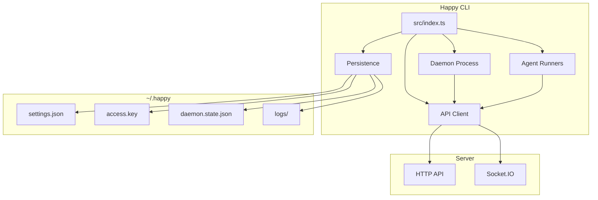

## High-level layout
- **Entry point:** `src/index.ts` parses subcommands and routes execution.
- **API client:** `src/api` handles HTTP + Socket.IO, encryption, and RPC.
- **Daemon:** `src/daemon` runs in the background, spawns sessions, and maintains machine state.
- **Persistence/config:** `src/persistence.ts` + `src/configuration.ts` manage local state in `~/.happy`.
- **Agents:** `src/claude`, `src/codex`, `src/gemini` provide provider-specific runners.

## CLI entry flow

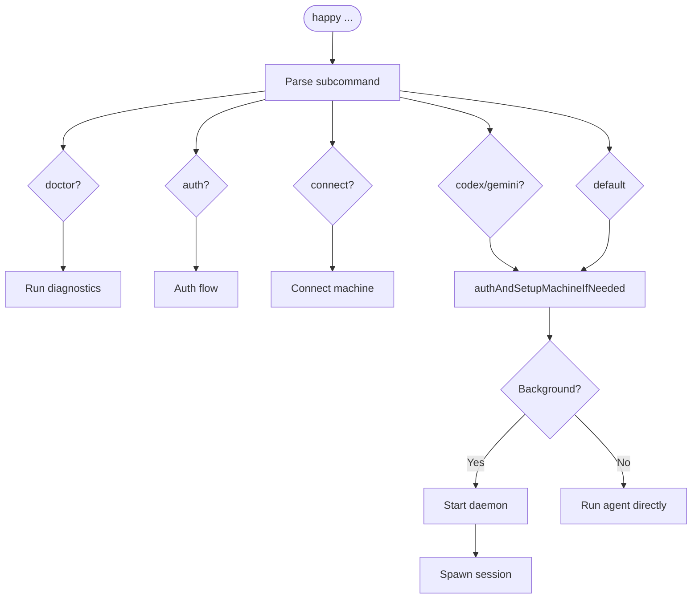

`src/index.ts` is the CLI router. It:
- Parses subcommands (`doctor`, `auth`, `connect`, `codex`, `gemini`, and default run flows).
- Ensures auth and machine setup when needed (`authAndSetupMachineIfNeeded`).
- Starts the daemon or runs an agent directly based on subcommand/context.

## Local state and configuration

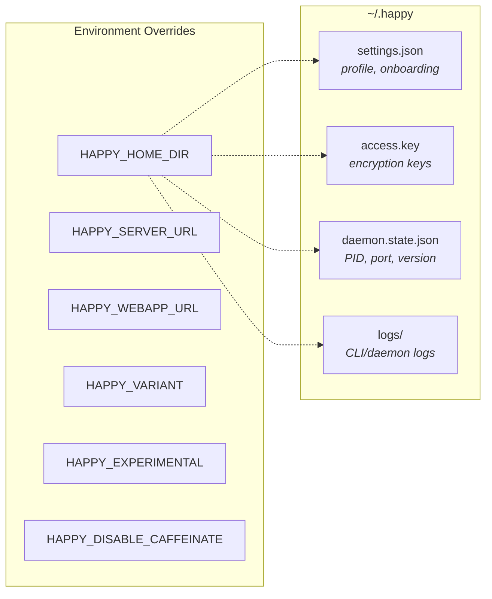

Local state lives under `~/.happy` (or `HAPPY_HOME_DIR`):
- `settings.json`: onboarding and profile settings (validated/migrated).
- `access.key`: local key material for encryption/auth.
- `daemon.state.json`: daemon PID + control port + version.
- `logs/`: CLI/daemon logs.

Configuration lives in `src/configuration.ts`:
- `HAPPY_SERVER_URL` and `HAPPY_WEBAPP_URL` override defaults.
- `HAPPY_VARIANT`, `HAPPY_EXPERIMENTAL`, `HAPPY_DISABLE_CAFFEINATE` control behavior.

## API client architecture

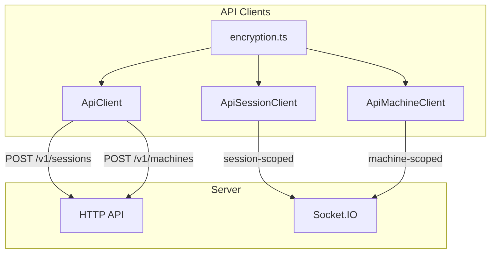

### HTTP
`ApiClient` (`src/api/api.ts`) handles:
- Session creation (`POST /v1/sessions`) with encrypted metadata/state.
- Machine registration (`POST /v1/machines`) with encrypted metadata/daemon state.
- Other CRUD actions through `ApiSessionClient` and `ApiMachineClient`.

### WebSocket

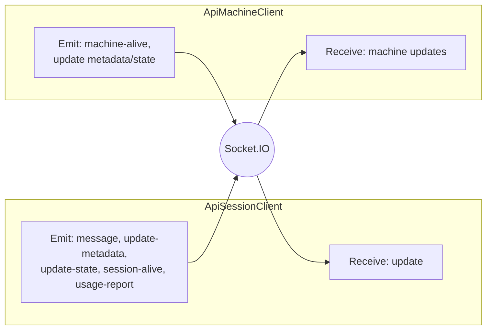

`ApiSessionClient` (`src/api/apiSession.ts`) connects to Socket.IO as a **session-scoped** client:
- Receives `update` events and decrypts message content.
- Emits `message`, `update-metadata`, `update-state`, `session-alive`, and `usage-report`.

`ApiMachineClient` (`src/api/apiMachine.ts`) connects as a **machine-scoped** client:
- Sends `machine-alive` heartbeats.
- Updates machine metadata/daemon state with optimistic concurrency.
- Receives machine updates and merges them locally.

### Encryption

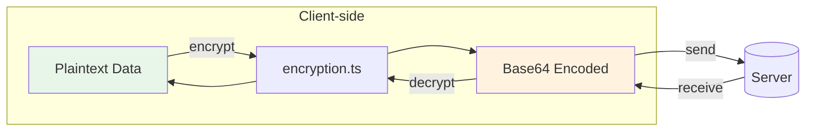

The CLI encrypts client content before it leaves the machine using `src/api/encryption.ts`.
- Session metadata, agent state, messages, machine state, artifacts, and KV values are encrypted client-side.
- On-wire encoding is base64; see `encryption.md`.

## Daemon architecture

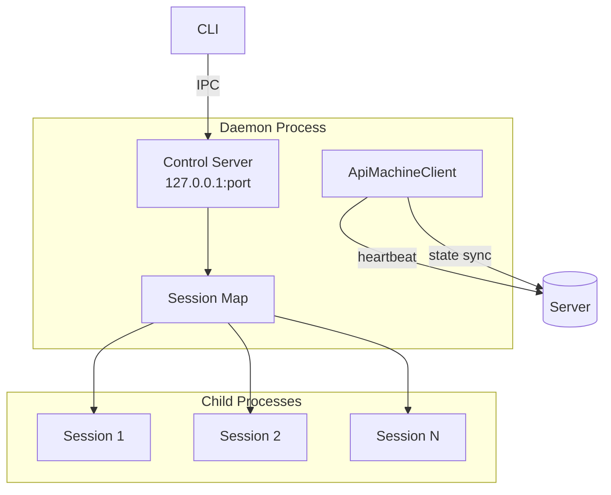

The daemon is a long-lived process responsible for running sessions in the background and maintaining machine presence.

### Lifecycle

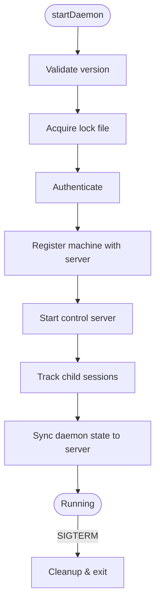

1. `startDaemon()` validates the running version and acquires a lock file.
2. It authenticates and registers the machine with the server.
3. It starts a local **control server** for IPC.
4. It keeps a map of tracked child sessions and updates daemon state on the server.

### Control server (local IPC)

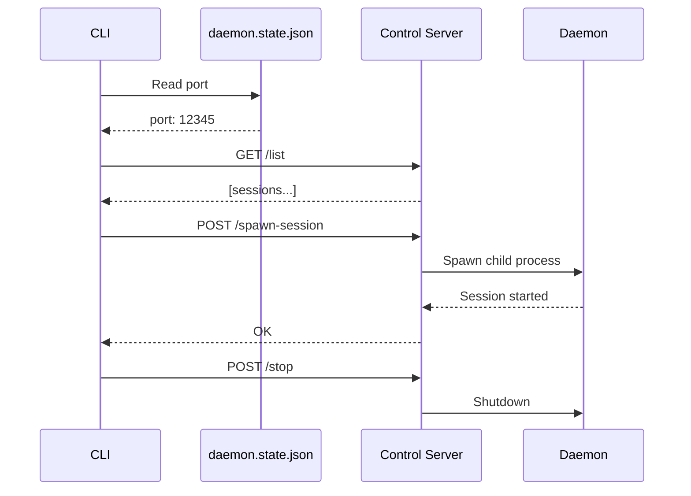

`startDaemonControlServer()` (`src/daemon/controlServer.ts`) runs an HTTP server on `127.0.0.1` and exposes:
- `/list` (list active sessions)
- `/stop-session`
- `/spawn-session`
- `/stop` (shutdown daemon)
- `/session-started` (session self-report)

The CLI talks to this server via `controlClient.ts`, using a port stored in `daemon.state.json`.

### Session spawning

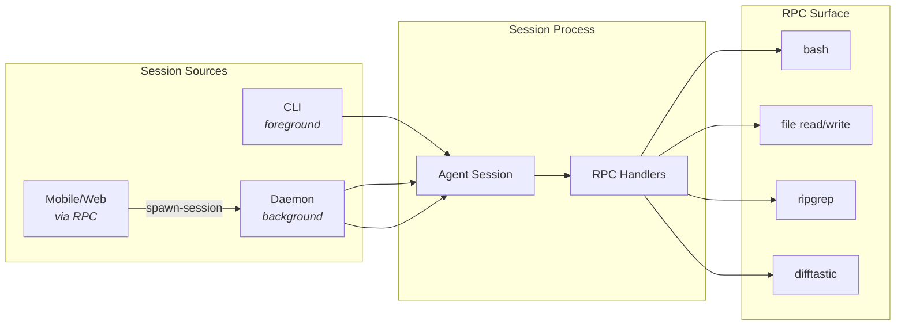

Sessions can be started by:
- The CLI directly (foreground).
- The daemon (background).
- Remote requests over RPC (from mobile/web via machine connection).

Daemon session spawning uses `registerCommonHandlers` to expose a controlled RPC surface (shell commands, file operations, search/diff helpers).

### Machine state

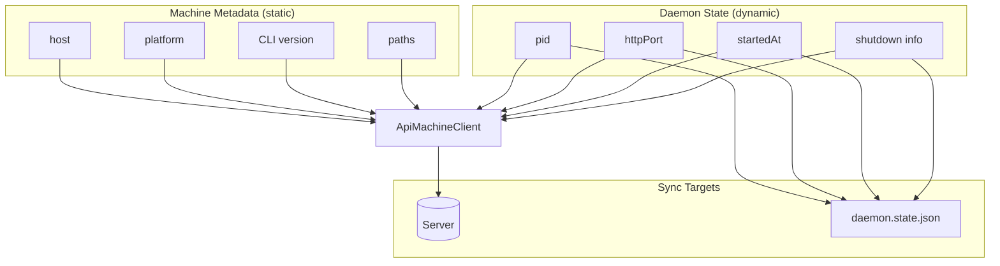

- **Machine metadata** is static info (host, platform, CLI version, paths).
- **Daemon state** is dynamic (pid, httpPort, startedAt, shutdown info).

The daemon updates these via `ApiMachineClient` and mirrors local state into `daemon.state.json` for control/diagnostics.

## RPC and tool bridge

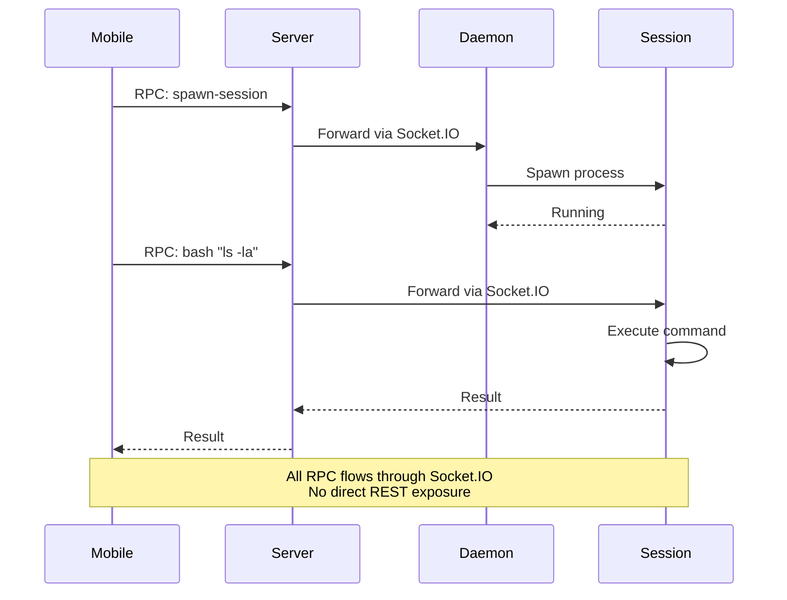

RPC is used to send commands over the Socket.IO connection:
- Sessions register RPC handlers (e.g., `bash`, file read/write, `ripgrep`, `difftastic`).
- The daemon registers a spawn-session handler so the server/mobile client can ask it to start a local session.

This mechanism allows the server and mobile clients to drive local actions without exposing a broad REST surface.

## Implementation references
- CLI entry: `packages/happy-cli/src/index.ts`
- Daemon: `packages/happy-cli/src/daemon`
- Control server/client: `packages/happy-cli/src/daemon/controlServer.ts`, `packages/happy-cli/src/daemon/controlClient.ts`
- API clients: `packages/happy-cli/src/api`
- Persistence: `packages/happy-cli/src/persistence.ts`
- Config: `packages/happy-cli/src/configuration.ts`

## Native Codex TUI mobile integration

Personal account bridge version 2 adds `codex --native-tui` for the paired `codex-account --account NAME --mobile` launcher. `nativeMobile.ts` starts a detached Happy worker or reconnects to an existing matching thread/account/directory. The worker owns the Unix app-server, relay connection and separate UUID lease helper; the foreground runs the real Codex remote TUI. Normal TUI exit leaves the worker alive. Happy session stop ends the backend and releases the lease after its process identity exits. The helper covers worker death while the helper remains alive; abrupt helper death is not an atomic process-and-lock guarantee.

Each terminal stays on one thread. `nativeMobileTransport.ts` rejects thread creation, forks and foreign-thread mutation before forwarding, and preserves WebSocket frame types. Read-only discovery remains available. Phone `/clear` is rejected before changing pending questions or queues. Open another account terminal to select another thread.

Sockets live in private, user-owned directories under `HAPPY_HOME_DIR/native`. This mode requires the paired account entry and Codex Unix app-server/remote-TUI support; ordinary Happy Codex mode remains available. Startup failures point to that session's worker log. Ready files describe active workers, not phone connectivity. Model credentials stay with the local account launcher.

`CodexAppServerClient` forwards native user messages, associates completions with turn IDs, and consumes authoritative completion status rather than inferring success from idle. Peer resolution aborts outstanding approval/question waits. Happy-origin message IDs prevent duplicate relay echoes. Async question reply envelopes are rendered as question-and-answer text in native input forwarding and thread backfill; the original Codex input remains unchanged. Unknown or malformed envelopes remain verbatim. Empty threads are materialized with `thread/name/set` before first attachment.

In native mobile mode, the Codex thread name is copied from start/resume/fork responses and `thread/name/updated` notifications to Happy's existing `metadata.summary.text`. The iOS session list and chat header both read that field; no app update or additional model request is needed for this mapping. Updates are scoped to the active thread, including when the backend uses legacy turn events. The bridge does not invent a title: a new empty thread currently starts with the materialization name `Codex mobile`, and a subsequent Codex rename replaces it. Installing a new CLI does not replace an already-running worker; it takes effect when a new worker starts. Old Happy records are not bulk-renamed on installation.

Native resume uses `excludeTurns` to separate backend readiness from historical message transfer. Before publishing the frontend socket it captures the latest turn ID using a metadata-only page; background `nativeHistory.ts` then walks chronological full-turn pages through that boundary. An empty snapshot stays empty even if new live turns appear. Mapping context persists across pages, and history delivery uses bounded batches with actual outbox confirmation rather than the best-effort `flush()` API. Historical reads and delivery failures are reported independently of the live session; shutdown aborts further work. No provider history is rewritten. This avoids both eager full-history serialization in `thread/resume` and a second full-history `thread/read` on the startup path. Ordinary Happy and fork backfill retain their existing behavior. A single exceptionally large turn can still exceed the provider request deadline; that is reported as incomplete history rather than a failed native startup.

Development checks on macOS with Codex 0.167.0 exercised real-account startup, cold resume, normal detach/reattach, fixed-thread rejection and terminal resizing. The iPhone displayed a native-origin input and reply. Phone-origin submission, the installed command and fleet acceptance remain separate checks; protocol tests do not establish them. Installation and current acceptance are maintained in `system-config/happy-personal/README.md`.

## Native Codex TUI feasibility (2026-11-12, historical baseline)

At the time of this experiment, the installed mobile entry used Happy's Ink display. An isolated experiment connected the actual Codex 0.167.0 TUI and the Happy CLI client built from fork commit `dd4e4550bf8019e9dae7dc39faee06f5f84fc611` to the same app-server/thread. This is historical feasibility evidence. The [official remote-TUI interface](https://learn.chatgpt.com/docs/app-server#connect-the-cli-terminal-ui) provides the connection primitive.

The experiment ran on one macOS host with an isolated `HOME`/`CODEX_HOME`, a localhost Responses API fixture, and an OS sandbox denying non-local outbound connections. The real Happy `CodexAppServerClient` used a disposable stdio-to-WebSocket adapter. Its question and approval handlers were test consumers; the full Happy runner, relay, real model account, and iPhone app were not part of this experiment. Do not treat its outputs as phone acceptance or as a configuration-preservation check.

Observed cases:

| Case | Result and boundary |
| --- | --- |
| Attach two clients | A thread with a completed first turn could be resumed by the second client. An unknown UUID was rejected. A newly created thread before its first turn returned `no rollout found`; adding `excludeTurns` did not remove that error in the tested calls. Blank-thread attachment needs separate handling. |
| Bidirectional terminal turns | The actual native TUI displayed a peer-origin user message and response; a TUI-origin message and response appeared in the raw peer subscription. Happy received start, assistant response, and completion events for the TUI-origin turn, but omitted its user message. |
| TUI detach and reconnect | Normal TUI exit returned code 0. With the experiment supervisor still alive, Happy completed another turn in that thread; the reattached native TUI displayed it. This did not test closing the supervisor's terminal or disconnecting it during an active turn. |
| Command approval | One Happy-side denial and one native-TUI approval produced distinct rejected/completed tool results. A separate direct call on the actual Happy client showed that peer `serverRequest/resolved` left its pending approval count at 1, and a later local answer still attempted a response. Backend acceptance of that late answer and actual phone-card behavior were not tested. |
| Native question | One `request_user_input` answer B reached the model tool result. A direct resolved-notification check changed the actual Happy question AbortSignal from false to true. Actual phone form dismissal was not tested. |
| Input during an active turn | With one protocol-origin turn held at the model fixture, Happy's second input was accepted and persisted as another user message in the same turn. Its promise remained pending until release. This was one controlled overlap, not a test of every concurrent ordering or native keyboard steering. |
| Cross-client cancellation | Two directions reached native `interrupted` status. When the Happy-origin turn was canceled by the peer, Happy returned `aborted:false` and emitted `task_complete/completed`; when Happy canceled the peer-origin turn without its own pending completion promise, it emitted `turn_aborted`. |

The cancellation mismatch has a concrete ordering: `thread/status/changed` with `idle` arrived before `turn/completed` with `interrupted`. In `codexAppServerClient.ts`, `handleRawNotification` currently treats idle as a successful completion when a pending turn exists. `emitRawTurnCompletion` then records the turn as complete, suppressing the later authoritative completion event. Idle cannot establish that a turn succeeded.

Before promoting this route to the normal mobile launcher, the fork maintainer needs to address the observed gaps: forward external user messages without duplicating Happy-origin inputs; cancel approval waits when another client resolves them; preserve authoritative interruption results; and establish blank-thread attachment. Shared turn tracking must respect that input can join an existing turn. The existing question AbortSignal path can be reused, but its phone consumer still needs acceptance.

The later integration stage must also verify account selection/configuration, new/resume entrypoints, process ownership and deliberate stop versus TUI detach, phone submission/approval/question behavior over the existing public relay, and reconnects. These are pending integration work, not capabilities delivered by this experiment. No change to relay deployment or phone networking was made.

Evidence is retained in the task artifact set `20261110-happy-mobile-01a1c5ad/work/native-tui`: `interactive-events-1.jsonl` and `happy-events-1.json` (shared turns), `terminal-receipts.json` (TUI exit/reconnect outputs with original transcript locators), `probe-events.jsonl` and `mock-requests.jsonl` (approval/question tool results), `peer-resolution-result.json` (resolved notification comparison), and `concurrency-events.jsonl`/`concurrency-result.json` (overlap and cancellation). The associated scripts are task-local experiments, not supported installation commands. An independent read-only review checked the raw records and client implementation; it did not add phone or real-provider coverage.
